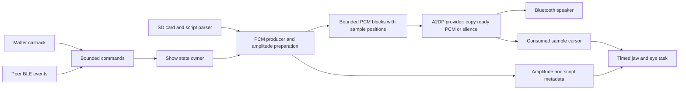

# Story 001 — Prototype Anthony with one WROVER, onboard SD and Matter

- **Status:** In progress; SD/config, audible A2DP and Home-triggered diagnostic tone demonstrated. Native startup WAV is flashed and Cam confirmed it complete and clear. Gate 1 peer/resource/recovery acceptance remains open.
- **Date:** 2026-10-14, America/Edmonton.
- **Scope owner:** Cam.
- **Working branch:** `codex/onboard-sd-migration`.

**Research:** [sibling audit, primary sources and decisions](../research/2026-10-14-single-wrover-research.md).

## Outcome

Anthony should run its audio, jaw, eyes, existing direct BLE link to Jeff, and
Apple Home Matter accessory on a single classic ESP32-WROVER development board.
Its onboard SD slot replaces the unreliable external reader. Anthony's removable
board and plug-in eye/servo leads permit a bench prototype before rebuilding the
perfboard. Preserve Jeff's legacy protocol and original image/card. The physical
correction below supersedes the initial hardware assumption: this prototype
currently borrows Jeff's v3.0 board, whose original flash was backed up and
verified before the authorized prototype upload. No physical secondary is
currently available for concurrent pair acceptance.

This is a feasibility story with explicit exit gates. There is no local proof yet
that the complete workload fits or remains reliable on one WROVER. If it fails,
retain the onboard SD improvement and the C3 Matter trigger. A measured decision
to retain two processors is a valid experiment result, but does not satisfy the
single-WROVER feature's acceptance criteria.

On 2026-10-15 Cam authorized implementation and flashing the attached board.
The earlier Arduino SD migration remains available in this worktree. See the
[implementation and hardware evidence log](../validation/2026-10-15-implementation-log.md)
for actual results and outstanding gates.

## User story and boundaries

As the owner of two Halloween skulls, I want to control Anthony from Apple Home
and motion automations while it coordinates directly with Jeff, so I can simplify
the electronics without depending on good Wi-Fi coverage between the skulls.

Required invariants:

- Anthony is the primary; Jeff is the unchanged secondary. Existing SD content,
  role configuration, speaker selection, skit selection and weighted history
  behavior remain recognizable. Keep `/config.txt`, `/audio`, WAV and script names.
- The peer link remains direct BLE. It must not need an AP, mDNS, Internet or a
  Matter controller to deliver a skit command. Home control still requires usable
  Wi-Fi; this change cannot cure a disconnected motion sensor or Home network.
- Both speakers remain A2DP sinks; each skull is an A2DP **source**. A successful
  A2DP sink example is not a substitute for testing this direction.
- Preserve the existing filename/acknowledgment handshake and Jeff's behavior.
  Do not add clock synchronization, new messages, a new server, or a Jeff update.
- Keep the current busy/cooldown policy: no overlapping skits, no replay of stale
  commands after reconnect, and a ten-second post-skit cooldown. A cold boot or
  restored Matter attribute must never start a skit.
- Use the socketed board/jumpers first. Final perfboard fabrication, permanent
  power distribution, Jeff's separate fault, OTA, web UI, ESP-NOW, Wi-Fi peer
  transport, and certification/productization are outside this story.

The source currently puts the BLE peer link on the WROVER, not the C3. The C3
provides an incoming Matter-trigger pulse. This is verified source architecture;
the actual binaries on the two physical skulls still need to be identified.

## Chosen starting point

Use a separate native-IDF prototype directory, leaving the working Arduino
application available. The candidate is **ESP-IDF 5.5.4 + managed ESP-Matter 1.5.0**,
as used by the newest local Lightbox, Box of Death and occupancy work. It is the
best locally understood starting point, not a claim of the newest upstream SDK.

Resolve dependencies for target **esp32**, preserve the generated lock, and pin
the IDF commit, Matter package/hash, CHIP revision and any patch. Do not copy a
C3 dependency lock or generated `sdkconfig` wholesale. The research records
upstream recommendation differences; the initial compile/link gate decides
whether this exact local pair is viable for classic ESP32. If it fails, make one
documented version decision before proceeding, rather than mixing moving SDKs.

Use **one Bluedroid host/controller in BTDM**. Matter is a Wi-Fi accessory, not a
Matter controller, Apple Home hub, Thread router or radio bridge. NimBLE cannot
provide Classic A2DP, and a second independent Bluetooth host is not the solution.

Prefer the existing legacy PCM A2DP source API for the bounded feasibility port.
IDF 5.5.4 still includes it, marked deprecated. Record this deliberate dependency.
The newer encoded-data API requires a separate codec/API decision; do not silently
bundle that migration into the first radio experiment. Adapt native-IDF profile
handling instead of importing the complete old Arduino Bluetooth wrapper.

## Gate 0 — Hardware identity and a recoverable baseline

The verified flash backup and onboard SD/config baseline are observed; the
remaining physical/full-show items below are still acceptance requirements.

1. Identify the exact development board and revision, module, flash size, PSRAM,
   onboard slot routing, antenna type, servo model and LED current-limiting parts.
   “WROVER” names a module family; it does not guarantee a card slot. Compare the
   actual board against its schematic. Record photos and a connector/pin table.
2. Back up Anthony's card, firmware/flash layout and relevant configuration using
   a method appropriate to the actual board and security settings. Keep private
   device identities and provisioning material outside Git. Record a reversible
   restore procedure before changing the partition table or flashing native IDF.
3. Record the working Arduino/C3 baseline: speaker names, connection time,
   initialization audio, representative skits, jaw alignment, paired start skew,
   idle/active heap if available, and known glitches. Confirm Jeff's deployed
   server behavior through Anthony's current client and serial observations.
4. Establish a power topology for this bench assembly. Servo power comes from
   a suitable external supply with common ground, not a GPIO or the 3.3 V rail.
   Confirm LED resistors/driver remain present when the old header/perfboard is
   removed. Avoid a USB/external-supply connection that back-powers the old board;
   the user's reported backfeed is unresolved, and no diode design is assumed.
5. First run the already prepared SD-only Arduino migration with the C3 still
   available. Validate mounting, config, speaker, jaw and unchanged Jeff link.
   This separates a wiring/SD fault from a later framework or radio fault.

Candidate pin map, conditional on the confirmed FREENOVE board routing:

| Function | Candidate connection | Constraint |
| --- | --- | --- |
| SDMMC CLK / CMD / D0 | GPIO14 / GPIO15 / GPIO2 | 1-bit, 20 MHz; required physical pull-ups and boot behavior must be confirmed |
| Jaw signal | GPIO23 | Servo previously occupied GPIO15; remove old SPI MOSI connection before use |
| Eyes | GPIO32 / GPIO33 | Preserve current limiting and correct polarity |
| Servo power / ground | External supply / shared ground | Verify supply transient behavior under actual jaw load |
| Optional local test trigger | To be selected after board audit | Do not copy the current GPIO1 input, which conflicts with UART0 TX |

The slot also connects GPIO4/12/13 on the reference board even in 1-bit mode;
do not casually assign them to other loads. Reserve flash/PSRAM, strapping,
input-only and onboard-connected pins appropriately. The C3 source emits on
GPIO4 while older wiring docs say GPIO1: settle the actual pulse wiring before
using the baseline, rather than reproducing that discrepancy.

**Pass:** repeatable SD/audio/jaw/Jeff baseline on the unplugged Anthony board,
known wiring and restore path. Otherwise fix the physical baseline first.

## Gate 1 — Prove the stack before porting the show

Build the smallest disposable probe with Matter, Bluedroid BTDM, A2DP source and
a BLE GATT client. Start with deterministic generated PCM; then exercise a real
speaker and real Jeff. Keep the probe separate from the production sketch and
avoid a large abstraction framework before feasibility is known.

### Shared Bluetooth lifetime

One module owns controller/host initialization and shutdown. Inspect the selected
versions, then prove this sequence rather than assuming example startup is safe:

1. Initialize and **enable** the controller in BTDM before Matter's asynchronous
   BLE setup can take the idle path. Initialize/enable Bluedroid exactly once.
2. Register/initialize A2DP source and the application GATT client through that
   owner. Adapt their profile logic; remove example-only memory-release policy.
3. Start Matter with its Bluedroid backend. Keep ongoing BLE enabled after
   commissioning (`CONFIG_USE_BLE_ONLY_FOR_COMMISSIONING=n` intent), and verify
   the actual backend's commissioned-boot, reset and fabric-removal paths.
4. Ensure no library calls mode-memory release or controller/host teardown while
   another user still needs it. Matter's default idle path releases Classic
   memory; IDF's standalone A2DP source example releases BLE memory. Both are
   inappropriate for the shared owner. See research references R10–R13.

### Callback composition

Matter needs GATTS and BLE GAP events; Anthony needs GATTC and BLE GAP events.
Use distinct interfaces/app identifiers and sufficient connection resources.
Classic GAP is separate from BLE GAP; do not conflate the two registries.

IDF 5.5.4 exposes `esp_ble_gap_get_callback()`. First investigate a deliberate
BLE GAP dispatcher that preserves/forwards the installed Matter handler while
routing the peer scanner's events. Establish a reliable “Matter handler ready”
point; waiting an arbitrary number of milliseconds is not an ownership contract.
Test later registration, reboot, commissioning window reopen and teardown. No
event payload pointer may outlive its callback without a bounded owned copy.

If public composition is inadequate, investigate a narrow pinned SDK hook with
upstream precedent. Record and regression-test it. Do not repeatedly overwrite
the callback, reach through undocumented private members, or maintain a broad
Matter fork to force the first prototype through.

### Commissioning route

The preferred user experience is normal Apple Home addition using Matter's
shared-Bluedroid commissioning transport. Confirm the endpoint appears, an On
command is received, and credentials/fabrics survive a restart.

An optional early isolation experiment may disable **only CHIPoBLE**, provision
Wi-Fi separately and try on-network commissioning. It leaves the application BLE
client intact. It is not accepted solely because chip-tool works: actual iPhone
Home addition, correct discovery bits/setup payload, reset/re-add and a usable
network-change procedure must pass. Record the added provisioning burden before
choosing this route. A permanent SoftAP or serial-only normal onboarding is not
an assumed product requirement.

### Gate evidence

Record resolved config, map/size report, Bluetooth initialization/state trace,
allocation failures and capability-specific heap minima. Demonstrate A2DP to the
real speaker, a successful original-protocol exchange with Jeff, and actual
Apple Home commissioning/control on the same binary. Include commissioning with
Bluetooth initialized and a deliberate concurrent-load stress trial; ordinary
commissioning can remain an idle maintenance operation.

**Pass:** the selected stack links and runs with correct shared ownership,
acceptable memory headroom and working Home/peer/source roles. Synthetic audio
is sufficient for this gate only. If the gate fails, stop the full application
port and record whether version adjustment, an onboarding tradeoff, or retaining
the C3 is justified.

## Gate 2 — Port a bounded audio and animation pipeline

The [legacy semantics audit](../research/2026-10-15-legacy-audio-semantics.md)
records exact current script/mute boundaries, RMS constants, selection behavior
and existing bugs to compare explicitly during this port.

Do this after Gate 1. The current A2DP callback reads SD, holds a mutex, runs
animation/analysis and may log or allocate. Merely moving it to a second core
does not solve those problems. Death is a useful partial refactor, not a complete
real-time implementation to copy wholesale.

### Data and timing contract

- One producer owns SD file handles and buffering. Parse RIFF chunks, including
  padding/unknown chunks, and validate PCM format before starting a track. Current
  repository assets are 44.1 kHz, stereo, signed 16-bit; actual SD assets must be
  inventoried. Preserve stereo frame alignment; remove the hardcoded 128-byte skip.
- Use preallocated blocks/ring with clear ownership and bounded transfer sizes.
  Never read more bytes than can be retained; short reads, EOF and SD errors are
  distinct states. Prebuffer a configured amount before accepting local playback.
- The A2DP provider copies only ready samples, completely initializes every
  returned byte and pads starvation with silence. It does no SD access, String
  construction, serial output, script parsing, servo work, blocking wait or BLE
  transaction. Record counters with bounded synchronization, not verbose logs.
- Separate file-sample position, submitted/transmitted-PCM position and inserted
  silence. EOF is complete only after queued content has drained; flushing/stopping
  invalidates old blocks. Starvation must not advance the script as if speech
  samples were successfully consumed, nor replay old PCM after recovery.
- Compute RMS/envelopes outside the provider. Associate them with block/sample
  positions. Drive animation from the **consumed** audio cursor and script
  timeline, not the producer's read-ahead position. Publish compact metadata and
  use a nonblocking actuator tick, including idle breathing.
- Preserve role-based **audio muting**, not only jaw movement. Prepare an A/B
  speech mask indexed by source samples and apply it before each PCM block is
  delivered, including boundaries within a block. Anthony must remain silent
  during Jeff's lines. Prepare role-aware envelopes from the same timeline.
  Actuator latency compensation must not delay the PCM mask; the original
  callback-driven mute flag is not an adequate cross-task timing contract.
  Initialization/Marco/Polo and other non-skit audio need explicit unmuted rules.
- Speaker buffering adds latency after the provider. Measure audible alignment
  with the actual JBL devices; establish a documented compensation policy. A
  correct sample cursor alone does not prove jaw-to-sound or skull-to-skull sync.
- Use separate LEDC timer/channel allocations for servo pulses and eye PWM.
  Confirm servo pulse limits and default closed position before attaching the
  mechanism. A long movement must not block a control, Matter or audio task.

The current 8 KiB PCM ring holds about 46 ms. Compare 16/32/64 KiB candidates only
within measured RAM and latency budgets (about 93/186/372 ms of PCM capacity).
More buffering can absorb SD scheduling jitter; it cannot create radio airtime,
and read-ahead must not lead the jaw. Do not interpret ring capacity as measured
end-to-end latency.

### State ownership and overload

| Context | Owns or does | Must not do |
| --- | --- | --- |
| Matter callback/system layer | Validate commands, bounded enqueue, attribute updates on its permitted context | Run skits, wait for BLE ACK, touch SD, move servo |
| BLE stack callbacks | Copy bounded event data, complete client state transitions through queued events | Block for ACK or do application file work |
| Show controller task | Idle/prepare/await-peer/play/cooldown/error state, selected skit, deadlines, trigger policy | Race callbacks on mutable skit/String state |
| SD/PCM producer task | File handles, RIFF/parser state, PCM/envelope production | Hold shared locks across SD reads |
| A2DP source callback | Ready PCM consumption, silence padding, sample/counter publication | Wait on producer or acquire a contended long-held mutex |
| Actuator task | Jaw/eye hardware and interpolation | Delay-loop breathing or replay stale metadata |
| Diagnostic task | Periodic snapshots and bounded logs | Print continuously on the source path |

Use FreeRTOS queues, explicit ownership and appropriately synchronized counters.
`volatile` and pinning tasks to different cores are not synchronization. Keep
critical sections tiny; never perform I/O or a delay inside them. Prefer a
well-understood bounded buffer primitive over an improvised lock-free queue.

Command overflow rejects a new trigger visibly through counters/state; it never
queues an unlimited backlog. Animation updates may replace obsolete positions.
Critical disconnect/error events must survive queue pressure through reserved
capacity or separately latched state. Define cancellation, buffer generation and
ownership on every state transition so a late ACK or old EOF cannot start a new
show. The protocol has no command ID: enforce one outstanding peer request and
test late-response quarantine explicitly.

## Gate 3 — Preserve Jeff's protocol and add a Matter trigger

### BLE compatibility contract

| Field | Existing contract to retain |
| --- | --- |
| Jeff advertising name | `SkullSecondary-Server` |
| Service UUID | `4fafc201-1fb5-459e-8fcc-c5c9c331914b` |
| Characteristic UUID | `beb5483e-36e1-4688-b7f5-ea07361b26a8` |
| Request | Existing raw filename string such as `/audio/Skit - name.wav`; preserve bytes and length semantics |
| Success response | Existing filename acknowledgment/readback after Jeff checks file existence and not-currently-playing; it does not prove playback began |
| Failure | Existing `Error: Cannot play ...` response and timeout behavior |
| Timing | Jeff queues playback on receive; Anthony queues after successful reply/readback; no future start timestamp |
| Current timeout | 100 ms settling delay then up to five seconds waiting; measure and preserve compatible deadlines using a nonblocking state machine |

Confirm actual MTU, write type, terminating-NUL behavior, CCCD settings and reply
transport from the working client. Source advertises READ/WRITE/INDICATE while
the server calls `notify()`; the native client must match real Jeff, not assume
that correcting a property is harmless. Preserve error handling and read-after-
notification verification: the current client fails on notification timeout; it
does not accept readback alone as a fallback success.
Verify scan API units rather than copying the current `10000` constant/comment.
Connect to the intended skull and speaker using validated existing configuration;
avoid accidental pairing with an unrelated device advertising a similar name.

Do local file/script validation and bounded prebuffering before commanding Jeff
where possible, so a local SD error is detected early. After Jeff receives the
command it can already start: the existing protocol cannot guarantee atomic
two-skull start if the reply is lost. Do not automatically retransmit a skit and
risk duplicate playback. Record this inherited limitation and fail the request
without later surprise starts. Quantify any timing change introduced by earlier
prebuffering; preserve acceptable audible behavior, not a presumed fixed offset.

There is a second inherited limitation: Jeff's validator does not check its
speaker connection. The server notifies before dispatching the playback callback,
which can then refuse playback if A2DP is disconnected. Test this exact case and
report it as a protocol limitation. Anthony cannot infer confirmed audible Jeff
playback from the existing acknowledgment alone. Fixing that guarantee would
require a separately scoped Jeff/protocol change.

### Matter behavior

Use one incoming OnOff server endpoint compatible with the existing C3's visible
Apple Home control. Confirm the exact device type/UI label during Gate 1. A
generic-switch input endpoint emits physical button events; it is not the direct
replacement for “turn on Anthony.”

Treat On as a momentary trigger. The callback validates endpoint, cluster,
attribute and value, then submits a bounded request. Schedule an Off reset on the
Matter system layer, guarded so the internal reset does not trigger work. Use one
managed timer/work item; do not create/leak a timer per press or delay inside its
callback as older C3 code does. Off resets the trigger representation; it is not
an undocumented mid-skit stop command.

While busy, unready or within cooldown, ignore/reject the start according to the
existing behavior and return the momentary state to Off. Distinguish “Matter
write received” from “paired skit started” in diagnostic evidence. No restored
attribute, startup hydration, reconnect, duplicate notification or internal
attribute write may cause playback. Test successive Home taps and automation
commands, including repeated On while already On, using the selected SDK callback
semantics. Do not promise exactly-once behavior for new external commands that
lack application identifiers; the busy/cooldown state prevents retriggering.

The WROVER is a new Matter accessory identity. Do not clone the C3's fabric keys,
device certificates or commissioning identity. Keep the C3 accessory available
for rollback and retarget Apple Home automations only after the replacement is
accepted. App-only updates must preserve the WROVER's own fabric/NVS/factory data.
Changing native/Arduino partition layouts is a separate full-image transition
requiring the Gate 0 restore plan, not an ordinary app-only update.

## Core placement, RF policy and resource budgets

Start from Espressif's documented coexistence configuration, not an assumed
“core 0 radio/core 1 application” split. Put Bluetooth controller and Bluedroid
host on one core and Wi-Fi on the other. Record the resolved options:
`CONFIG_ESP_COEX_SW_COEXIST_ENABLE`, Bluetooth controller/host affinity and
`CONFIG_ESP_WIFI_TASK_CORE_ID`. Verify both cores are enabled for the target.

Matter's application task and SD/animation tasks still share these cores. Measure
their runnable time, stack high-water marks and queue/ring low-water marks before
pinning application tasks. Keep application priorities below critical stack
tasks. Compare a default-affinity control build with the documented separated
radio-task build; change one parameter per experiment. Do not disable watchdogs
or raise producer priority above radio tasks to conceal starvation.

RF policy for the prototype:

- Wi-Fi uses station mode. Keep established speaker/peer connections during a
  show. Prefer initial discovery and pairing while idle; pause optional scans
  during playback. A dropped peer is recorded, then reacquired with bounded
  idle retries. Existing local playback can finish without a continuous peer tick.
- Reconnect Wi-Fi with bounded backoff; never restart Bluetooth to repair Wi-Fi.
  Test AP loss/reappearance, because scanning/connection can consume more airtime
  than an established quiet Matter subscription. Local diagnostic triggering and
  BLE/audio must remain usable while Home is unreachable.
- Keep coexistence/power-save defaults initially. Do not blindly retain the old
  `ESP_COEX_PREFER_WIFI` call or enable full BLE scan windows. Compare any later
  change against the same repeatable workload with metrics.
- Treat commissioning, new speaker pairing and intentional factory reset as
  maintenance operations. Exercise their worst-case load separately; do not
  require an owner to commission in the middle of a show to use the product.
- Record antenna orientation, enclosure, distance and obstructions during yard
  tests. Moving tasks cannot create a second RF path. Do not infer that an
  external antenna exists, or can be switched, from the WROVER name alone.

Track internal free/minimum heap, largest free block, DMA-capable allocation
headroom, PSRAM and per-task stacks separately. Internal RAM is the likely tight
budget; total PSRAM is not a substitute. Start with a small internal ready-audio
buffer and preallocated metadata; evaluate bulk read-ahead in PSRAM only after
measuring cache/timing behavior. Do not assume classic ESP32 can DMA directly
from arbitrary PSRAM. Audit flash/NVS writes during playback and avoid unnecessary
persistence of momentary triggers.

Before the soak, record explicit buffer, queue, stack and heap budgets in the
evidence manifest. A proposed diagnostic floor is 32 KiB free internal heap,
16 KiB largest internal free block, and at least 25% unused space on application
task stacks after the worst measured commissioning/reconnect load. These are
initial guardrails, not vendor guarantees or proof against all allocations.
Raise them if observed maximum allocation/stack demand requires it. Lowering them
requires a documented allocation analysis and a fresh stress test, not merely a
successful boot. Log allocation failures as failures even if the device recovers.

## Implementation slices and proposed file layout

Future implementation should produce small reviewable increments, each preserving
the Arduino fallback. These paths describe planned files; none exists yet.

| Slice | Proposed area | Deliverable |
| --- | --- | --- |
| A: exact-stack probe | `firmware/`, `main/`, `sdkconfig.defaults.esp32`, managed manifest/lock | Minimal Matter + BTDM + generated-PCM source + peer client; Gate 1 result |
| B: audio core | `components/skull_audio/` | RIFF parser, bounded PCM pipeline, consumed cursor, host tests |
| C: application state | `components/skull_show/` | Skit/config compatibility, nonblocking coordinator and deadlines |
| D: peripherals | `components/skull_board/` | SDMMC mount, verified pins, distinct PWM resources, nonblocking actuators |
| E: radio boundary | `components/skull_link/` | Shared lifecycle/dispatcher and original BLE client contract |
| F: Matter adapter | `main/matter_trigger.*` | OnOff command boundary, retention/reset/update rules |
| G: evidence | `docs/validation/` | Build identity, matrix, counters, bench/yard results, rollback instructions |

Choose the smallest useful module boundaries during implementation; this table
does not require a generic framework. Port selection/config/script logic with
tests before changing behavior. Treat the current PWM lag, WAV header skip and
callback deficiencies as explicit changes with their own comparisons, so a fix
is not mistaken for a radio regression.

## Validation and acceptance matrix

Results are recorded in the linked implementation log; this table defines the
acceptance requirements. Build success, synthetic
stress, real pair playback, and owner acceptance must be reported separately.

| Test | Procedure | Required result / evidence |
| --- | --- | --- |
| Portable audio tests | RIFF odd-sized/unknown chunks, truncated/unsupported headers, short reads, ring wrap/full/empty, EOF drain, A/B boundaries, non-skit audio, silence and frame alignment | Correct role mask and sample positions, no uninitialized tail, dropped bytes or stale blocks |
| State/adapter tests | Busy/cooldown, command overflow, timeout/late ACK, disconnect, cancellation, internal Off/reset/startup events | No overlapping or delayed surprise show; errors and queue pressure observable |
| Exact target build | Fresh resolved `esp32` build from pinned inputs | No NimBLE/Classic conflict; linked features and partition fit; no unrecorded patches |
| Cold boot | At least 10 power cycles on the prototype assembly | SD/config/PSRAM and expected links initialize without reset loops, SD failures or unintended playback |
| Real Jeff compatibility | At least 50 paired starts across representative skits; include missing file, busy, timeout and disconnected Jeff-speaker cases | Correct normal skit/roles; no duplicate starts; unchanged Jeff; measured ACK behavior and explicit record of ACK-without-playback limitation |
| Audio/animation baseline | Record both skulls and speakers; compare shortest/longest, quiet/loud and alternate-speaker segments | Correct content/frame order and speech assignment; jaw-to-sound and paired onset no worse than agreed baseline tolerance |
| Normal combined load | At least one hour, repeated skits, Home commands/subscriptions, jaw/eyes active | Zero unexplained underruns, audible glitches, allocations failed, watchdogs or resets; stable resource budgets |
| Weak Wi-Fi/recovery | At least 10 AP-loss/return or equivalent controlled reachability cycles, including mid-skit; then actual yard placement | BLE/local audio continue; no command replay; Home recovers; reconnect contention measured |
| Link failures | Separately remove speaker and Jeff during idle and playback; restore each | Bounded recovery, no scanning storm or stale start; deterministic local completion/abort and safe jaw state |
| Matter lifecycle | Actual iPhone Home add/control/reboot, commission window reopen, intentional remove/reset/re-add on prototype only | Correct identity, no Bluetooth teardown conflict, no boot-trigger; record controller/OS/hub versions |
| Update preservation | App-only upgrade using generated partition/flash arguments | Existing native fabrics/settings retained; no automatic NVS erase |
| Mount/read failure | Absent card at boot; controlled read-failure injection without corrupting the owner's card | Clear fault state, no format-on-failure, no out-of-bounds/replayed audio, safe actuator result |
| Owner check | Cam observes Anthony plus unchanged Jeff at intended spacing | Explicit acceptance of audio quality, jaw timing, control usability and physical prototype |

Use `esp_timer_get_time()` or equivalent instrumentation for callback execution
and queue latency. Initial diagnostic goals are provider p99 under 1 ms and no
sample over 5 ms; compare these against the real requested-frame cadence before
adopting them as final limits. A quiet counter does not prove a clean RF stream:
record actual sound as well as software starvation.

Measure audible paired-start skew and jaw offset with a shared recording, then
set baseline-relative limits before judging the new build. A proposed tolerance
is no more than 20 ms additional p95 skew/offset versus the working baseline,
subject to measurement resolution and Cam's observed result. If the original
baseline is already unacceptable, equality is not acceptance; record and resolve
that separately without claiming this unchanged protocol supplies precision sync.

For intentional failures, count injected silence/disconnections separately from
unexplained failures. Planned speaker removal cannot satisfy an uninterrupted
audio requirement, but must produce the defined safe/recoverable behavior.
Evidence includes firmware and SDK hashes, resolved config, hardware/card identity,
test duration, raw counters/log excerpts and links to recordings. Store secrets,
fabric material and private provisioning data outside Git.

## Completion, fallback and open decisions

The feature is complete only after all applicable gates pass and Cam accepts the
single-WROVER prototype. Documentation or a compiler result cannot close hardware
acceptance. Do not remove the C3 permanently or rebuild both perfboards until then.

If radio timing, internal RAM, Home onboarding or stable callback composition
fails: stop and preserve the evidence. Return to the known Arduino/onboard-SD
baseline with the C3 trigger using the matched firmware/wiring/partition restore
procedure. Jeff stays unchanged. Do not silently substitute Wi-Fi peer control
or claim that adding more PSRAM solves RF contention.

Open decisions to resolve in order:

1. Actual Anthony board/slot/power wiring and deployed baseline identity.
2. Exact classic-ESP32 dependency pair and required resources from Gate 1.
3. Stable Matter/BLE initialization and GAP composition; normal versus explicitly
   accepted on-network commissioning if needed.
4. Real Jeff notification/indication behavior and baseline audible timing.
5. Measured buffer/task/core/heap budgets and speaker-latency compensation.

## Work log and next action

- **2026-10-14:** Audited current sibling sources, lockfiles and recorded hardware
  results; inspected pinned upstream Bluetooth/Matter code and coexistence docs.
  Read-only RIFF parsing verified all 15 repository WAV formats/data offsets.
  Wrote this plan and research record. No firmware changed, built or flashed in
  this planning pass. No new commissioning or hardware result is claimed.
- **2026-10-14 review:** Independently checked the story against source. Clarified
  Jeff's ACK-without-playback limitation and sample-indexed role muting. Local
  document links were checked; hashes of all 18 firmware source/header files
  matched the start of this research pass. The main checkout remains clean at
  `e4b48ff`; earlier SD migration changes remain only in the worktree.

**Current next action:** finish Gate 1 Home/A2DP acceptance on the running probe
before the full native audio/application port. Record the missing physical
secondary as a hardware hold on peer acceptance, rather than a software pass.

### Physical correction and implementation authorization — 2026-10-15

Cam found that Anthony's original WROVER PCB is v2.1 and has **no onboard SD slot**.
Jeff's WROVER PCB is v3.0 and has the slot. The attached v3.0 board is borrowed
from Jeff and now holds Anthony's card. Only Anthony had a C3; under Jeff's board
was a USB-C PD power module. Thus the prototype retains Jeff's **protocol** and
backs up his original board image, but necessarily replaces the borrowed board's
firmware. A physical secondary skull is currently unavailable for pair acceptance.
Cam plans to buy another v3.0 board if the experiment succeeds. Eyes and jaw are
disconnected; both speakers are powered. These facts supersede assumptions of
identical PCB revisions and an immediately available unchanged physical Jeff.

### Live probe observations — 2026-10-15

- Original v3.0 flash was read and verified before the authorized layout change.
- Native probe reads Anthony's card: primary, configured Flip 5, 15 WAVs/11 scripts.
- UART records completed live Matter commissioning and committed fabric state.
  Home control and reboot persistence are separate checks.
- No native speaker connection or audio callbacks have yet been observed.
  Jeff is powered off; it cannot be a competing Bluetooth source.
- Default Matter allocation reached 17,039 bytes minimum internal free during
  commissioning, below the proposed 32 KiB floor. A supported external Matter
  allocator experiment is in progress; no resource gate is declared passed.
- Cam cannot perform physical checks for roughly an hour. Continue software and
  serial diagnostics; audible playback and real-secondary checks remain held.

Details and evidence paths are in the [implementation log](../validation/2026-10-15-implementation-log.md)
and [discovery/memory research](../research/2026-10-15-radio-memory-debugging.md).

### Speaker follow-up — 2026-10-15

After powering the speakers back on and enabling pairing, the probe discovered
the configured Flip 5, connected, and started 44.1 kHz A2DP streaming. Cam heard
the explicit second diagnostic tone and identified Anthony's speaker. This passes
the bounded audible synthetic-source check. Short-run internal minimum was
26,959 bytes, so the resource guard remains open. Home-triggered tone, longer
combined-load/peer evidence, and the full SD/audio/actuator port are still pending.

### End-to-end trigger and unattended hardening — 2026-10-15

Cam located the existing accessory in Outside/Other and confirmed Home On played
the diagnostic tone and returned off. Speaker identity/address is now cached
only after a selected successful connection; card name changes invalidate its
use. The latest source also adds bounded retry/backoff, selected ACL observation,
and connection/teardown timeouts after repeat abrupt-reset failures. The trial
that enabled incoming page scanning was not consistently successful and was
reverted; see the research/validation notes rather than treating its first good
boot as a fix.

The radio-event payload moved to PSRAM with internal scheduler control retained.
Matter and mbedTLS use supported external heap modes; stacks remain internal and
unchanged. Latest-image short boot measurements exceeded the proposed 32 KiB
internal minimum, but final fresh commissioning, peer exchange, full workload and
soak acceptance remain open. Static IRAM has only 1,573 bytes free. Full native
SD/audio/actuator port remains behind Gate 1's real-secondary/resource evidence.

### Explicit startup announcement extension — 2026-10-15

Cam requested restoring the initialization WAV before the full skit port. Added
a bounded once-per-boot PSRAM-preloaded clip, triggered by A2DP media readiness.
The first uploaded run delivered the primary WAV; Cam confirmed it was complete
and clear, including the beginning and end. No jaw/eye or skit application integration is implied. See the
[startup evidence](../validation/2026-10-15-startup-announcement.md). The full
Gate 2 pipeline remains behind real-peer/resource acceptance.

### Explicit jaw/eye bench extension — 2026-10-15

After Cam connected the documented jumpers, enabled GPIO23 servo and GPIO32/33
eyes for a gentle startup check and initialization speech animation. App-only
flash and output initialization trace are verified; Cam confirmed both eyes and jaw work. This bounded extension does not close the held full skit/Jeff gates.
See [jaw/eye evidence](../validation/2026-10-15-jaw-eyes.md), including open
callback elapsed and internal memory limits from the new image.

### Restored idle breathing — 2026-10-15

Restored legacy30° breathing with2s open,100ms hold,2s close on a7s start-to-start
cadence, using the existing control tick. Audio cancels breathing. Driver host
tests, native build and app-only upload pass; Cam confirmed the physical
breathing looks right. See [breathing evidence](../validation/2026-10-15-idle-breathing.md).
Battery keep-alive behavior has not been measured on this prototype.

### Goal authorization for remaining native port — 2026-10-15

Cam requested actively porting the remaining application before the replacement
ESP32 arrives, then explicitly included startup eye diagnostics. Proceed with
software integration and single-board/host proof while preserving all real-peer,
resource and full-show acceptance holds. The earlier instruction to stop all
Gate2 code until live Gate1 peer proof is superseded for this authorized work;
its acceptance requirements remain. See the
[application port record](../validation/2026-10-15-native-application-port.md).

### Follow-up catalogue/recovery qualification — 2026-10-15

All 11 skits passed paired on the same image on both boards: complete source
frames, zero underruns/watchdogs/unexpected resets. Cam confirmed clean turns
and Home interaction under playback. Marco precedes requested Polo; diagnostic
flashes are slower with a two-second error-group gap. Targeted LEDC containment
and SBC encoder optimization address observed reset/stutter failures. Missing-card
reinsertion, quick speaker power-cycle recovery, busy-reboot refusal and idle
reboot were checked. Names repository timing now ends exactly at EOF.

The [qualification record](../validation/2026-10-15-code-qualification.md) preserves
failed captures and exact image identity. Primary internal-heap window minimum
29379 bytes remains below the proposed 32 KiB diagnostic floor. Jeff actuators,
measured acoustic offset, yard soak and uncontrolled-reset SD recovery remain
open; late speaker return after the bounded retry episode needs explicit retry.
